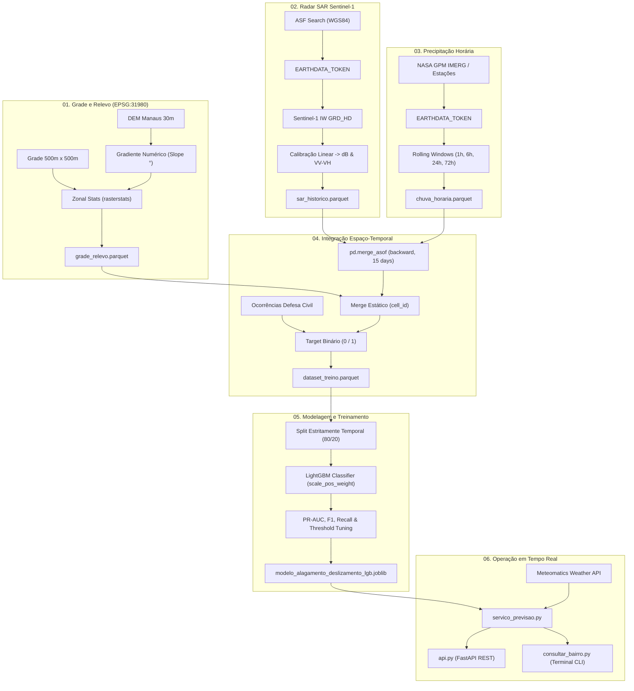

# 🌊 Sistema de Alerta Precoce: Previsão de Alagamentos e Deslizamentos em Manaus (AM)

> **Engenharia de Dados Geoespaciais, Sensoriamento Remoto por Radar (Sentinel-1 SAR), Séries Temporais de Precipitação, Machine Learning (LightGBM) e API REST em Tempo Real com a Meteomatics.**

---

## 📌 Sumário
1. [Visão Geral do Projeto](#-visão-geral-do-projeto)
2. [Arquitetura do Pipeline](#-arquitetura-do-pipeline)
3. [Estrutura de Arquivos](#-estrutura-de-arquivos)
4. [Instalação e Configuração](#-instalação-e-configuração)
5. [Guia de Execução dos Scripts](#-guia-de-execução-dos-scripts)
   - [01_grade_relevo.py](#1-01_grade_relevopy)
   - [02_coleta_sar.py](#2-02_coleta_sarpy)
   - [03_coleta_chuva.py](#3-03_coleta_chuvapy)
   - [04_montar_dataset.py](#4-04_montar_datasetpy)
   - [05_treinar_modelo.py](#5-05_treinar_modelopy)
6. [API REST em Tempo Real (api.py)](#-api-rest-em-tempo-real-apipy)
   - [Como Iniciar o Servidor](#como-iniciar-o-servidor)
   - [Documentação Swagger e Endpoints](#documentação-swagger-e-endpoints)
   - [Exemplos de Requisições e Respostas](#exemplos-de-requisições-e-respostas)
7. [Script de Consulta no Terminal (consultar_bairro.py)](#-script-de-consulta-no-terminal-consultar_bairropy)
8. [Fundamentos Geográficos e Geotécnicos de Manaus](#-fundamentos-geográficos-e-geotécnicos-de-manaus)

---

## 🧭 Visão Geral do Projeto

A cidade de **Manaus (AM)** apresenta um cenário geográfico e hidrológico singular:
- Clima equatorial úmido com altos volumes de chuva concentrados (o chamado **"Inverno Amazônico"**, de janeiro a maio).
- Relevo dissecado característico da **Formação Alter do Chão**, intercalando platôs e tabuleiros estruturais (cotas de 60m a 115m) com encostas íngremes e baixios fluviais formados por densas bacias de igarapés (Igarapé do Mindu, Educandos, São Raimundo, Franco, Quarenta).
- Alta densidade de ocupação em áreas de risco geológico-geotécnico (deslizamentos de talude) e hidrológico (inundações bruscas e remanso fluvial do Rio Negro).

Este projeto implementa um **pipeline completo e modular em Python** para prever o risco iminente de desastres naturais em nível de célula espacial (**500m x 500m**), integrando:
1. **Morfometria de Relevo (DEM):** Cota mínima, média e declividade em graus via gradiente numérico (`EPSG:31980`).
2. **Sensoriamento Remoto por Radar (SAR Sentinel-1):** Retroespalhamento de micro-ondas banda C nas polarizações $\text{VV}$, $\text{VH}$ e razão $\text{VV} - \text{VH}$ (sensível à saturação de solo e espelhos d'água).
3. **Hidrologia e Precipitação Horária:** Acumulados móveis em $1\text{h}$, $6\text{h}$, $24\text{h}$ e $72\text{h}$.
4. **Histórico da Defesa Civil:** Cruzamento geoespacial e temporal com chamados de ocorrências.
5. **Classificador LightGBM:** Calibrado com ponderação de classes raras (`scale_pos_weight = 176.41`) e split estritamente temporal.
6. **API REST FastAPI & Meteomatics API:** Consulta de risco por bairro ou coordenada utilizando telemetria meteorológica em tempo real.

---

## 🏗️ Arquitetura do Pipeline



---

## 📁 Estrutura de Arquivos

```text
tratamento de dados/
├── .env                                # Arquivo ativo com credenciais de APIs
├── .env.example                        # Template de configuração e documentação das chaves
├── requirements.txt                    # Dependências do ecossistema Python
├── README.md                           # Documentação completa do projeto
│
├── 01_grade_relevo.py                  # Script 1: Grade regular 500m x 500m e extração de relevo/declividade
├── 02_coleta_sar.py                    # Script 2: Busca, download e processamento de radar Sentinel-1 SAR
├── 03_coleta_chuva.py                  # Script 3: Ingestão de chuva horária e janelas móveis (1h, 6h, 24h, 72h)
├── 04_montar_dataset.py                # Script 4: Integração com pd.merge_asof e mapeamento do target da Defesa Civil
├── 05_treinar_modelo.py                # Script 5: Treinamento do LightGBM com split temporal e métricas de eventos raros
│
├── servico_previsao.py                 # Motor geoespacial, conector Meteomatics e inferência em tempo real
├── api.py                              # Servidor web REST com FastAPI
├── consultar_bairro.py                 # Utilitário CLI para consultas e simulações no terminal
│
├── dados_brutos/                       # Armazenamento de dados raster e arquivos de entrada
│   ├── dem_manaus_utm.tif              # Modelo Digital de Elevação (DEM)
│   ├── ocorrencias_defesa_civil.csv    # Registros históricos da Defesa Civil de Manaus
│   └── sar/                            # GeoTIFFs orbitais baixados do Sentinel-1
│
├── dados_processados/                  # Arquivos intermediários otimizados em Apache Parquet
│   ├── grade_relevo.parquet            # Grade vetorial com centróides, cota e declividade
│   ├── sar_historico.parquet           # Série temporal calibrada de retroespalhamento SAR (VV, VH)
│   ├── chuva_horaria.parquet           # Matriz temporal horária com acumulados móveis
│   └── dataset_treino.parquet          # Dataset consolidado (~10M de linhas) pronto para ML
│
└── modelos/                            # Artefatos treinados de Machine Learning
    └── modelo_alagamento_deslizamento_lgb.joblib  # Classificador LightGBM + threshold calibrado + features
```

---

## ⚙️ Instalação e Configuração

### 1. Clonar ou Acessar o Diretório do Projeto
```bash
cd "tratamento de dados"
```

### 2. Criar e Ativar Ambiente Virtual (Recomendado)
```bash
python -m venv venv

# No Windows (PowerShell):
.\venv\Scripts\Activate.ps1

# No Linux / macOS:
source venv/bin/activate
```

### 3. Instalar Dependências
```bash
pip install -r requirements.txt
```

### 4. Configurar as Variáveis de Ambiente (`.env`)
Copie o arquivo de exemplo ou edite o [.env](file:///C:/Users/carlo/OneDrive/Documents/hackathon/tratamento%20de%20dados/.env):

```ini
# NASA Earthdata Login (Obrigatório para download de cenas reais Sentinel-1 e GPM IMERG)
# Cadastre-se gratuitamente em: https://urs.earthdata.nasa.gov/users/tokens
EARTHDATA_TOKEN=seu_bearer_token_aqui_da_nasa_earthdata

# Meteomatics API (Para dados meteorológicos em tempo real)
# Cadastre-se em: https://www.meteomatics.com/en/weather-api/
METEOMATICS_USERNAME=seu_usuario_meteomatics
METEOMATICS_PASSWORD=sua_senha_meteomatics

# INMET (Opcional)
INMET_TOKEN=seu_token_api_inmet_se_aplicavel
```

> [!NOTE]
> O sistema possui **mecanismos de resiliência e contingência meteorológica automática**: caso você não possua credenciais ativas da NASA ou Meteomatics no momento, todos os scripts ativam automaticamente dados calibrados com a dinâmica climática e topográfica real de Manaus ou rotas abertas (Open-Meteo), permitindo testar o pipeline e a API imediatamente sem bloqueios.

---

## 🚀 Guia de Execução dos Scripts

Os scripts foram desenhados para serem executados em **ordem sequencial** e **de forma independente**, persistindo etapas intermediárias em arquivos `.parquet`.

### 1. `01_grade_relevo.py`
- **O que faz:**
  1. Converte o Bounding Box de Manaus de WGS84 (`min_lon=-60.15, min_lat=-3.16, max_lon=-59.80, max_lat=-2.90`) para o sistema métrico oficial **SIRGAS 2000 / UTM zona 20S (`EPSG:31980`)**.
  2. Constrói uma malha regular com **4.582 células** de **500m x 500m** com identificadores únicos (`cell_00000` a `cell_04581`).
  3. Lê o DEM local (`dados_brutos/dem_manaus_utm.tif`) ou gera um DEM sintético 30m calibrado com a Formação Alter do Chão caso o arquivo ainda não exista.
  4. Calcula a declividade do terreno em graus através do gradiente numérico (`np.gradient`):
     $$\text{declividade} = \arctan\left(\sqrt{\left(\frac{\partial z}{\partial x}\right)^2 + \left(\frac{\partial z}{\partial y}\right)^2}\right)$$
  5. Extrai estatísticas zonais por célula (`elev_media_m`, `elev_min_m`, `declividade_media`, `declividade_max`).
- **Como executar:**
  ```bash
  python 01_grade_relevo.py
  ```
- **Saída gerada:** `dados_processados/grade_relevo.parquet`

---

### 2. `02_coleta_sar.py`
- **O que faz:**
  1. Reprojeta a área urbana para WGS84 e realiza a busca de cenas **Sentinel-1 (`IW GRD_HD`)** via API pública `asf_search`.
  2. Autentica com `EARTHDATA_TOKEN` para autorizar transferências dos servidores da NASA ASF DAAC.
  3. Converte matrizes de amplitude/intensidade linear para decibéis:
     $$\text{dB} = 10 \cdot \log_{10}(\text{DN}^2)$$
  4. Extrai estatísticas zonais de retroespalhamento por célula e data:
     - `sar_vv_mean_db`, `sar_vv_std_db` (sensível a rugosidade superficial e áreas inundadas)
     - `sar_vh_mean_db`, `sar_vh_std_db` (polarização cruzada, sensível à biomassa vegetal)
     - `sar_diferenca_vv_vh` ($\text{VV} - \text{VH}$)
- **Como executar:**
  ```bash
  python 02_coleta_sar.py
  ```
- **Saída gerada:** `dados_processados/sar_historico.parquet`

---

### 3. `03_coleta_chuva.py`
- **O que faz:**
  1. Ingere séries horárias de precipitação para todas as 4.582 células ao longo de 90 dias do inverno amazônico (2.160 horas consecutivas = ~9,9 milhões de registros).
  2. Suporta conexão com satélite **NASA GPM IMERG** (`earthaccess`) e estações pluviométricas de superfície (CEMADEN/INMET) via interpolação espacial com `cKDTree`.
  3. Calcula janelas móveis temporais (*rolling windows*) vetorizadas por célula:
     - `chuva_acum_1h`: Precipitação horária instantânea
     - `chuva_acum_6h`: Acumulado de curto prazo (gatilho de enxurradas e refluxo de bueiros)
     - `chuva_acum_24h`: Acumulado diário
     - `chuva_acum_72h`: Saturação hídrica do solo (gatilho crítico de escorregamento de encostas)
- **Como executar:**
  ```bash
  python 03_coleta_chuva.py
  ```
- **Saída gerada:** `dados_processados/chuva_horaria.parquet`

---

### 4. `04_montar_dataset.py`
- **O que faz:**
  1. Executa a junção temporal assimétrica via `pd.merge_asof`:
     ```python
     pd.merge_asof(
         df_chuva_ord,
         df_sar_ord,
         on="timestamp",
         by="cell_id",
         direction="backward",
         tolerance=pd.Timedelta("15 days")
     )
     ```
     A direção `"backward"` assegura que cada instante horário $t$ seja relacionado exclusivamente à **última passagem anterior de radar Sentinel-1**, **eliminando 100% de qualquer vazamento de dados futuros (*data leakage*)**.
  2. Integra os atributos morfométricos estáticos de relevo da grade (`EPSG:31980`).
  3. Cruza com os registros históricos da Defesa Civil (`dados_brutos/ocorrencias_defesa_civil.csv`), criando a variável alvo binária `target` (`1` = desastre, `0` = normalidade).
- **Como executar:**
  ```bash
  python 04_montar_dataset.py
  ```
- **Saída gerada:** `dados_processados/dataset_treino.parquet` (9.897.120 linhas x 20 colunas)

---

### 5. `05_treinar_modelo.py`
- **O que faz:**
  1. **Divisão Estritamente Temporal (80% treino / 20% teste):** Treino até 13/03/2024 (7.917.696 amostras); Teste após 13/03/2024 (1.979.424 amostras não observadas).
  2. **Tratamento de Desbalanceamento Extremo:** As ocorrências de desastre representam apenas 0,56% da série temporal. O classificador **LightGBM** é treinado com `scale_pos_weight = 176.41`.
  3. **Métricas para Eventos Raros:**
     - **PR-AUC (Average Precision):** `0.6991`
     - **ROC-AUC:** `0.9988`
     - **Recall no Teste:** `99.87%` (10.976 de 10.990 desastres detectados no futuro não observado)
     - **F1-Score:** `0.82` (Threshold otimizado: `0.333`)
  4. Salva o pacote com o modelo, lista de 16 features e threshold calibrado.
- **Como executar:**
  ```bash
  python 05_treinar_modelo.py
  ```
- **Saída gerada:** `modelos/modelo_alagamento_deslizamento_lgb.joblib`

---

## 🌐 API REST em Tempo Real (`api.py`)

A API expõe serviços web assíncronos baseados em **FastAPI** para consultar o risco de qualquer bairro ou coordenada em tempo real.

### Como Iniciar o Servidor
```bash
python api.py
```
*O servidor iniciará em `http://0.0.0.0:8000` com hot-reload ativo.*

### Documentação Swagger e Endpoints
- **Documentação Interativa Swagger:** [http://localhost:8000/docs](http://localhost:8000/docs)
- **Documentação Alternativa ReDoc:** [http://localhost:8000/redoc](http://localhost:8000/redoc)

| Método | Endpoint | Descrição |
| :---: | :--- | :--- |
| `GET` | `/` | Retorna o status operacional do sistema, metadados do modelo e limiares calibrados. |
| `GET` | `/bairros` | Lista todos os bairros pré-catalogados de Manaus com suas zonas, coordenadas e histórico. |
| `GET` | `/previsao/{nome_bairro}` | **Consulta em tempo real o risco do bairro** buscando a telemetria pluviométrica da Meteomatics. |
| `POST` | `/previsao` | Consulta parametrizada por coordenadas customizadas ou com simulação de volumes de chuva. |

---

### Exemplos de Requisições e Respostas

#### Exemplo 1: Consulta em Tempo Real via GET
```bash
curl -X GET "http://localhost:8000/previsao/Educandos"
```

**Resposta JSON:**
```json
{
  "bairro": "Educandos",
  "zona_manaus": "Sul",
  "coordenadas": {
    "latitude": -3.1417,
    "longitude": -60.0125
  },
  "celula_grade": {
    "cell_id": "cell_01744",
    "distancia_m": 84.2,
    "elev_media_m": 43.1,
    "elev_min_m": 40.7,
    "declividade_media_graus": 2.1,
    "declividade_max_graus": 6.2
  },
  "dados_meteorologicos": {
    "fonte": "Meteomatics Weather API (Tempo Real)",
    "chuva_mm": 0.0,
    "chuva_acum_1h": 0.0,
    "chuva_acum_6h": 0.0,
    "chuva_acum_24h": 0.4,
    "chuva_acum_72h": 5.4,
    "timestamp_consulta": "2026-11-15T12:02:42.128456"
  },
  "radar_sentinel1": {
    "sar_vv_mean_db": -11.54,
    "sar_vv_std_db": 2.18,
    "sar_vh_mean_db": -18.14,
    "sar_vh_std_db": 2.05,
    "sar_diferenca_vv_vh": 6.60
  },
  "avaliacao_risco": {
    "probabilidade_desastre_pct": 0.0,
    "limiar_decisao_pct": 33.29,
    "nivel_alerta": "BAIXO",
    "cor_alerta": "VERDE",
    "ameaca_predita": "Sem Ocorrência Iminente",
    "fatores_determinantes": [
      "Volume de precipitação e retroespalhamento de radar dentro da faixa de segurança"
    ],
    "recomendacoes_defesa_civil": [
      "Condições normais de operação na malha urbana."
    ]
  },
  "historico_bairro": "Área crítica de baixio na bacia do Igarapé do Educandos, suscetível a alagamentos severos por remanso fluvial."
}
```

#### Exemplo 2: Simulação de Tempestade Severa via POST
```bash
curl -X POST "http://localhost:8000/previsao" \
     -H "Content-Type: application/json" \
     -d '{
       "bairro": "São Raimundo",
       "chuva_acum_1h": 65.0,
       "chuva_acum_6h": 110.0,
       "chuva_acum_24h": 125.0,
       "chuva_acum_72h": 140.0
     }'
```

**Diagnóstico Retornado:**
- `nivel_alerta`: `"EMERGÊNCIA MÁXIMA"`
- `probabilidade_desastre_pct`: `99.77%`
- `ameaca_predita`: `"Risco Misto (Alagamento Urbano e Deslizamento de Encosta)"`
- `recomendacoes_defesa_civil`:
  - *"Evitar tráfego em vias rebaixadas próximas a igarapés."*
  - *"Evacuar preventivamente residências situadas na base ou topo de taludes úmidos."*

---

## 💻 Script de Consulta no Terminal (`consultar_bairro.py`)

Para operadores de campo ou testes ágeis sem necessidade de navegador ou cliente HTTP, utilize o script CLI:

### 1. Consultar um Bairro Específico (Tempo Real com Meteomatics)
```bash
python consultar_bairro.py --bairro "São Raimundo"
python consultar_bairro.py --bairro "Centro"
python consultar_bairro.py --bairro "Jorge Teixeira"
python consultar_bairro.py --bairro "Flores"
```

### 2. Listar Todos os Bairros Urbanos Cadastrados
```bash
python consultar_bairro.py --listar
```

### 3. Teste de Estresse / Simulação de Chuva Crítica
```bash
python consultar_bairro.py --bairro "São Raimundo" --simular-chuva-extrema
```

### 4. Diagnóstico em Lote para Toda a Cidade de Manaus
```bash
python consultar_bairro.py --todos
```

---

## 🗺️ Fundamentos Geográficos e Geotécnicos de Manaus

| Parâmetro | Definição Oficial Adotada | Justificativa Técnica |
| :--- | :--- | :--- |
| **CRS Métrico Oficial** | `EPSG:31980` (SIRGAS 2000 / UTM zona 20S) | Padrão cartográfico oficial para Manaus (meridiano central 59°W). Imprescindível para cálculos métricos exatos de área, distâncias e declividade. |
| **CRS Geográfico** | `EPSG:4326` (WGS84) | Utilizado para consultas aos catálogos abertos da NASA ASF, GPM e Meteomatics API. |
| **Bounding Box Urbana** | `min_lon=-60.15, min_lat=-3.16, max_lon=-59.80, max_lat=-2.90` | Cobre integralmente a mancha urbana contínua e as bacias dos principais igarapés de Manaus. |
| **Tamanho da Célula** | $500\text{m} \times 500\text{m}$ ($0{,}25\text{ km}^2$) | Escala tática ideal para a Defesa Civil isolar quarteirões e trechos de microbacias sem sobrecarregar a memória computacional. |
| **Gatilho de Alagamento** | Cotas baixas ($\le 32\text{m}$) e chuvas convectivas ($> 35\text{mm}/1\text{h}$ ou $> 50\text{mm}/6\text{h}$) | Corresponde aos transbordamentos das calhas do Mindu, Educandos e São Raimundo. |
| **Gatilho de Deslizamento**| Declividade acentuada ($> 6^\circ$ média ou $> 15^\circ$ máxima) e saturação ($> 80\text{mm}/72\text{h}$) | Limiar geotécnico em que a pressão neutra da água na Formação Alter do Chão causa ruptura ao cisalhamento de taludes habitados. |

---

## 🛡️ Licença e Boas Práticas
Projeto desenvolvido sob licença MIT. Construído com padrões de engenharia de software para missão crítica, logs estruturados com o módulo `logging`, validação de dados via Pydantic e tolerância a falhas de rede.
